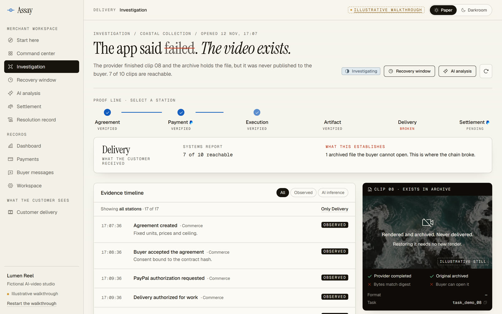
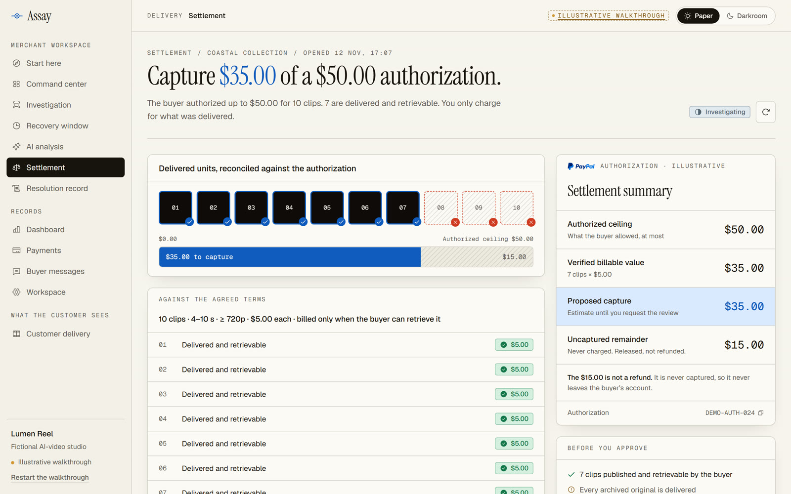
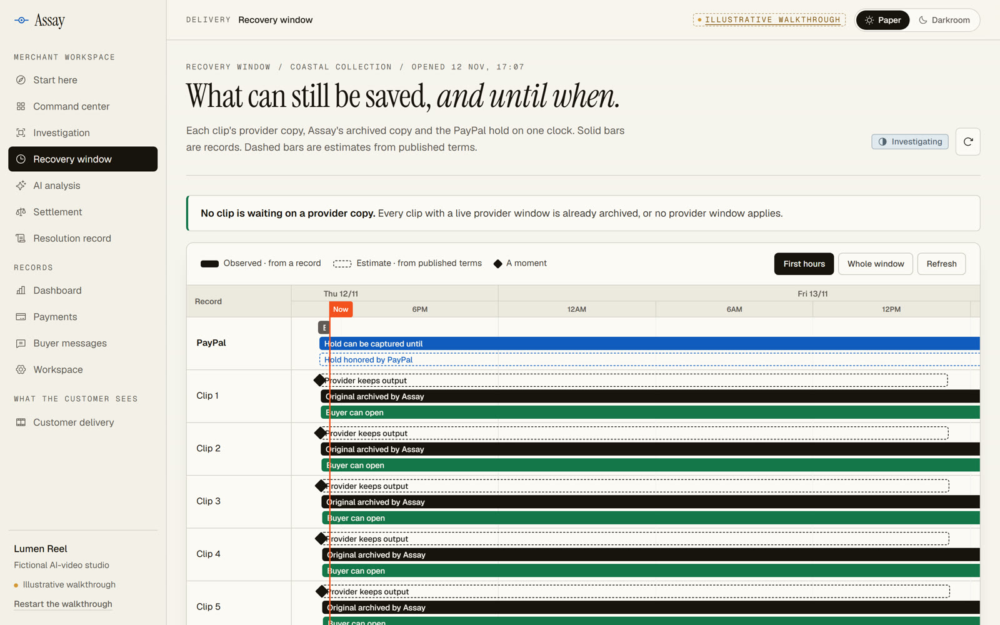

<div align="center">


# Assay

**Recover missing AI video. Charge for verified delivery.**

Assay helps video apps find finished clips that never reached the buyer.<br />
Recover the original, verify buyer access, and settle through PayPal.

[**Open the Sandbox demo**](https://assay-34-59-154-73.sslip.io/api/demo-login?as=operator&returnTo=%2F%23%2Fstart) · [Run locally](#run-locally) · [SDK and MCP](#plug-it-into-your-app) · [Release downloads](https://github.com/sankalp2515/Assay/releases)

[](https://github.com/sankalp2515/Assay/actions/workflows/ci.yml)
[](LICENSE)

<br />



</div>

In a [hosted Sandbox run](backend/evidence/hosted-sandbox-run.json), the buyer authorized **$50 for ten clips**. Assay recovered clip 08, verified access to eight clips, and PayPal confirmed **one $40 capture**. The remaining $10 was never charged. The demo provider used pre-generated LTX-Video clips.

## The problem

An AI-video provider can finish a render while the buyer still sees a failed delivery. A merchant has to find the original before the provider deletes it, decide whether another render is needed, and determine what to charge.

Generation APIs delete outputs on a timer:

| Provider | Output kept for | Source |
|---|---|---|
| Replicate | 1 hour | [docs](https://replicate.com/docs/topics/predictions/data-retention) |
| Google Veo | 2 days | [docs](https://aistudio.google.com/docs/veo) |
| Runway | 24–48 hours | [docs](https://docs.dev.runwayml.com/assets/outputs/) |

## What Assay does

Assay is **not a video generator**. It sits between the generator a business already uses and the buyer's PayPal payment:

1. **Authorize a ceiling.** The buyer agrees to fixed terms, and PayPal holds the maximum (10 clips × $5 = **$50**).
2. **Recover before re-rendering.** Assay archives each provider output as it finishes. When a clip goes missing, AI reads the records through read-only tools and cites what it used. The original file is restored, not generated again.
3. **Verify delivery.** A clip counts only when the buyer can fetch it through their own route and the bytes match the archived SHA-256. An outside cloud browser (KERNEL) also plays it.
4. **Capture the verified amount.** The merchant approves an exact, expiring proposal. In the reference case, PayPal confirmed one **$40** capture for eight clips. The other $10 was never charged.
5. **Prove it.** The buyer gets an Ed25519-signed per-clip statement that anyone can verify.

> **AI proposes. Rules decide. PayPal moves the money once.** AI never sets a price, approves a charge or moves money.

## How it works

<table>
<tr>
<td width="50%"></td>
<td width="50%"></td>
</tr>
<tr>
<td><b>Investigation.</b> A six-station proof line (agreement, payment, execution, artifact, delivery, settlement) shows where the chain broke. Records are tagged OBSERVED and AI output is marked as inference.</td>
<td><b>Settlement.</b> Every clip is reconciled against the agreed terms. Only clips the buyer can open are charged; the rest of the hold is never taken.</td>
</tr>
<tr>
<td></td>
<td>

**Recovery window.** Provider deletion timers, PayPal's honor period, the batch deadline and retention on one clock, so an operator sees what can still be saved.

*Screens above are from the in-browser walkthrough, which needs no backend. The same screens run live on PayPal Sandbox at the demo link.*

</td>
</tr>
</table>

### Where AI and PayPal are each essential

| Step | AI | Rules and people | PayPal |
|---|---|---|---|
| Buyer describes the problem in their own words | Reads free text into clip numbers, issue types and literal quotes; flags attempts to instruct the system | Validates quotes and clip numbers, then decides each clip from delivery and payment records | — |
| A clip looks missing | Investigates provider, delivery and payment evidence with scoped read tools and cites them | Checks citations against current evidence; restores only a verified original | — |
| Buyer approves the order | — | Immutable contract: clip count, price, ceiling | Orders API **AUTHORIZE** for the ceiling |
| Settlement | Cannot set prices, approve or move money | Server computes the amount from verified clips and the merchant approves an exact, expiring proposal | **Final partial capture** with an invoice reference and summary note, or a **void** when nothing was delivered |
| After settlement | — | Refunds bounded by the confirmed capture | **Refunds** against the original capture; **webhooks** verified with PayPal's signature API; read-back before anything shows as paid |

## For judges

| | |
|---|---|
| **Live product (one click)** | **[Open a live PayPal Sandbox workspace](https://assay-34-59-154-73.sslip.io/api/demo-login?as=operator&returnTo=%2F%23%2Fstart)**. It lands on **Start here** in your own isolated workspace (merchant, buyer and data) for 24 hours. The home page's **Run it live on PayPal Sandbox** button does the same. *Open demo* on the home page is the illustrative walkthrough, which needs no account. |
| **The guided job** | Start here walks you through agreement → PayPal hold → provider jobs → AI investigation → restore → exact capture → buyer's clips and signed statement. You play both merchant and buyer. |
| **PayPal approval** | Needs a PayPal Sandbox *personal* test account. Its login is in the Devpost testing instructions. Test money only. |
| **A verified reference case** | Batch `43b76034-08fa-4dea-959d-94d5e47492d0`: $50 authorization `5VS033985C290321J`, clip 08 restored, one $40 capture `6LH981233Y3805404`, both PayPal webhooks, 8 KERNEL playbacks, signed statement. All in [`hosted-sandbox-run.json`](backend/evidence/hosted-sandbox-run.json). |
| **Your own AI clips** | On Start here, open *Use your own clips* and paste up to three public `https` video links from any generator. Assay downloads, decodes, archives and delivers them like provider output. |
| **Merchant API** | Postman collection and hosted environment in [backend/docs/postman](backend/docs/postman). The sign-up invite code is in the Devpost testing instructions. |
| **Landing mirror** | https://assay-sandbox.onrender.com (static landing page and walkthrough only). |

## Run locally

The fixture walkthrough needs no credentials or test funds. Docker may need to download build dependencies on the first run. The demo container runs without network access.

```bash
git clone https://github.com/sankalp2515/Assay.git
cd Assay
cd backend
docker compose -f infra/compose.demo.yaml run --rm demo
```

Or with Node 22.20+, npm, and FFmpeg/FFprobe on `PATH`:

```bash
cd backend
npm ci
npm run demo
```

The demo runs all five services in one process on fixture PayPal, fixture AI and a locally encoded test MP4, and prints each step of the story. `npm run demo -- --real-ai` uses real Gemini for the AI steps and needs a free-tier key in `.env` ([INTEGRATIONS.md](backend/docs/INTEGRATIONS.md)).

<details>
<summary><b>Run the full UI locally</b></summary>

```bash
cd backend && npm ci && npm run provision
cd ../frontend && npm ci && npm run demo:ui
```

Open the printed case URL to get the merchant workspace, the buyer delivery and the payment record on the same five services, with fixture AI, fixture PayPal and a clip labeled as synthetic. `npm run demo:ui -- --sandbox` uses real PayPal Sandbox and a hosted model with your own credentials in `backend/.env`. Details: [frontend/README.md](frontend/README.md).

</details>

<details>
<summary><b>Run the microservices in containers</b></summary>

Five services, five PostgreSQL databases and the isolated media verifier. See [OPERATIONS.md](backend/docs/OPERATIONS.md#containers-11-november). The hosted deployment recipe is in [DEPLOY.md](backend/docs/DEPLOY.md).

</details>

<details>
<summary><b>Run the quality gate</b></summary>

```bash
cd backend
npm run verify:local
```

Type check, unit and integration tests, native PostgreSQL checks (concurrency, RLS, money bounds, encrypted restore) and the build. Results: `backend/evidence/local-quality.json`.

</details>

## Plug it into your app

Keep your provider and your generation code. Register each provider task as you submit it, and Assay archives the output when it finishes. Three steps: [INTEGRATE.md](backend/docs/INTEGRATE.md).

### Node SDK

Install the SDK from the GitHub release:

```sh
npm install https://github.com/sankalp2515/Assay/releases/download/v0.1.0/sankalp2515-assay-node-0.1.0.tgz
```

```ts
import { Assay } from "@sankalp2515/assay-node";

const assay = new Assay({ apiKey: process.env.ASSAY_API_KEY!, baseUrl: "https://assay.example.com" });

// 1. The buyer checks out: open a batch (idempotent on your order id).
const batch = await assay.batches.create(
  { buyer_id, unit_count: 10, unit_price_minor: 500, currency: "USD", prompt },
  "order-8812",
);

// 2. Your provider accepts a job: register it, and Assay archives the output when it finishes.
await assay.batches.registerTask(batch.id, { unit_id, source: "replicate", provider_task_id: "pred_abc" }, "unit-3-pred_abc");
```

| | |
|---|---|
| **Providers** | Runway and Replicate, looked up with the provider token configured on the deployment, or any provider that reports an output URL from a host you approved. Per-merchant provider credentials are not built yet |
| **Replicate connector** | For a deployment configured with a Replicate token: Replicate calls Assay when a render completes (Standard Webhooks signature) and the original is archived right away. Tested with signed fixture callbacks; a live Replicate recovery has not been run |
| **Keys and scopes** | A server key for you; an `integration` key can register work but can never approve a charge; short-lived buyer tokens for the browser |
| **Webhooks to you** | Signed events when a clip was recovered, when PayPal settled, and when a buyer opened a dispute |
| **AI agents** | An MCP server (`npm run mcp`) lets Claude Code or any MCP client open batches, register tasks and read evidence. It has no tool that approves or refunds money |
| **Currencies** | USD, EUR, GBP, CAD, AUD, JPY; one currency per batch |
| **Disputes** | Assay blocks new refunds while it knows of an open PayPal dispute on the capture; the signed statement is ready as evidence. Fixture-tested |
| **Your own PayPal** | Partner onboarding with `PayPal-Auth-Assertion`, pending PayPal partner approval |

### MCP server

Install the [MCP package](backend/mcp/README.md) from the same release. Configure your MCP client to run `assay-mcp` with `ASSAY_BASE_URL` and an `integration`-scope `ASSAY_API_KEY`. The server can open batches, register tasks, and read evidence. It exposes no payment approval tools.

### Continuous integration

[GitHub Actions](https://github.com/sankalp2515/Assay/actions) runs backend and frontend checks, builds, and package install checks for pull requests and pushes to `main`. Package publication has its own manually triggered workflow. Deployment remains in the [Google Cloud runbook](backend/docs/DEPLOY.md).

## Evidence

Every claim names its kind of evidence.

| Claim | Evidence | Kind |
|---|---|---|
| **Hosted end to end:** buyer approved a $50 hold in PayPal Sandbox checkout; AI investigation found the lost clip; original restored; **one $40 capture**; 8 KERNEL playback probes matched and played; signed statement verified with the public key | [`hosted-sandbox-run.json`](backend/evidence/hosted-sandbox-run.json) | Real PayPal Sandbox and hosted AI through the deployed UI; pre-generated LTX clips |
| PayPal webhooks `PAYMENT.AUTHORIZATION.CREATED` and `PAYMENT.CAPTURE.COMPLETED` for that run, verified and answered 200 | [`hosted-sandbox-run.json`](backend/evidence/hosted-sandbox-run.json), [`paypal-webhook.json`](backend/evidence/paypal-webhook.json) | Real PayPal Sandbox events |
| Merchant Postman collection against the hosted service: 23 requests, 21 assertions, 0 failures | [`postman-hosted-run.json`](backend/evidence/postman-hosted-run.json) | Hosted deployment, Newman |
| $50 authorization → $40 capture, $5 refund on the original capture, separate void | [`paypal-lifecycle.json`](backend/evidence/paypal-lifecycle.json) | Real PayPal Sandbox, adapter level |
| Five services, real Gemini, real Sandbox approval, one confirmed $40 capture | [`service-sandbox-workflow.json`](backend/evidence/service-sandbox-workflow.json) | Real Gemini and Sandbox; fixture media |
| A real AI-generated clip recovered and delivered byte-identical | [`generated-video-fixture-paypal.json`](backend/evidence/generated-video-fixture-paypal.json) | Real LTX output; fixture payment |
| AI reading of buyer messages: Gemini 25/30 vs keyword baseline 15/30, 0 invalid readings | [`claim-reading-evaluation.json`](backend/evidence/claim-reading-evaluation.json) | Real Gemini; 30 held-out messages; single run |
| AI action choice on structured facts: Gemini 17/20, rules 20/20. This is why AI does not decide actions | [`investigation-evaluation.json`](backend/evidence/investigation-evaluation.json) | Real Gemini |
| Concurrency, RLS, money bounds, encrypted restore | [`native-postgres.json`](backend/evidence/native-postgres.json) | Native PostgreSQL, local |
| Full local gate: 75/75 tests, 9 native PostgreSQL checks, type check, build | [`local-quality.json`](backend/evidence/local-quality.json) | Local, fixtures |
| Hosted container smoke, 16 checks | [`container-smoke.json`](backend/evidence/container-smoke.json) | Hosted deployment |

## Architecture

<div align="center">

</div>

Five Fastify services (**Commerce, Provider, Delivery, Investigation, Payments**), each with its own PostgreSQL database and row-level security, connected by a transactional outbox with idempotent consumers. An isolated media verifier with no credentials decodes every file.

- **Payments** alone holds PayPal credentials and the cash journal. Captures and refunds are reserved atomically; confirmed plus pending refunds can never exceed the confirmed capture.
- **Investigation** alone talks to models (Gemini primary, Groq and Vertex fallbacks).
- An unknown external write stays unknown until correlated evidence resolves it; retries reuse the original request identity.

Why five services instead of one app: [ARCHITECTURE.md](backend/docs/ARCHITECTURE.md#why-five-services-instead-of-one-app) · API: [API.md](backend/docs/API.md) · Security: [SECURITY_REVIEW.md](backend/docs/SECURITY_REVIEW.md) · Verification: [VERIFICATION.md](backend/docs/VERIFICATION.md)

## Built with

| Technology | What it does in Assay |
|---|---|
| **PayPal** Orders, Payments, Webhooks | Authorize the ceiling, one partial capture or void, refunds on the original capture, verified webhooks, dispute read-back |
| **KERNEL** | A cloud Chromium outside Assay's network fetches each delivered clip, matches its SHA-256 and plays it |
| **Postman** | Runnable merchant guide and contract test, run headless with Newman locally and against the hosted service |
| **Bryntum Scheduler** | The recovery window: provider deletion timers, PayPal honor period and deadlines on one timeline |
| **AG Grid / AG Studio** | The merchant dashboard: clips ordered, delivered and recovered, and how each PayPal hold was split |
| **APIMatic** | Contract review of our PayPal calls against PayPal's API definitions |
| **Google Cloud, Gemini** | Hosting (Compute Engine VM) and the investigation model |

Details for each: [SPONSORS.md](backend/docs/SPONSORS.md).

## Limits, stated plainly

- PayPal is **Sandbox only**. Only USD has run on real Sandbox. Non-USD currencies, disputes, merchant onboarding, GCS storage and Vertex AI are tested with fixtures.
- The hosted demo's provider is a labeled stand-in that reuses pre-generated LTX-Video clips. The Runway and Replicate adapters exist but no live provider job has been recovered on the deployment. The demo recovers one original per case; re-render cost avoided is a merchant-configured estimate, not a measured saving.
- The hosted Sandbox is a single-VM pilot: services, databases and media verifier on one e2-medium VM. Cross-database restore and failover are not yet tested.
- Demand evidence is user reports and provider documentation, not merchant interviews. Economics are illustrative.

## Repository

```
backend/    five services, SDK, MCP server, migrations, tests, evidence, docs
frontend/   merchant workspace, buyer delivery and landing page (React, Vite)
product/    problem statement, PRD and public sources
docs/media/ README screenshots
```

More: [Problem statement](product/PROBLEM_STATEMENT.md) · [PRD](product/PRD.md) · [Design system](DESIGN.md) · [Contributing](backend/docs/CONTRIBUTING.md)

## License

[MIT](LICENSE)
