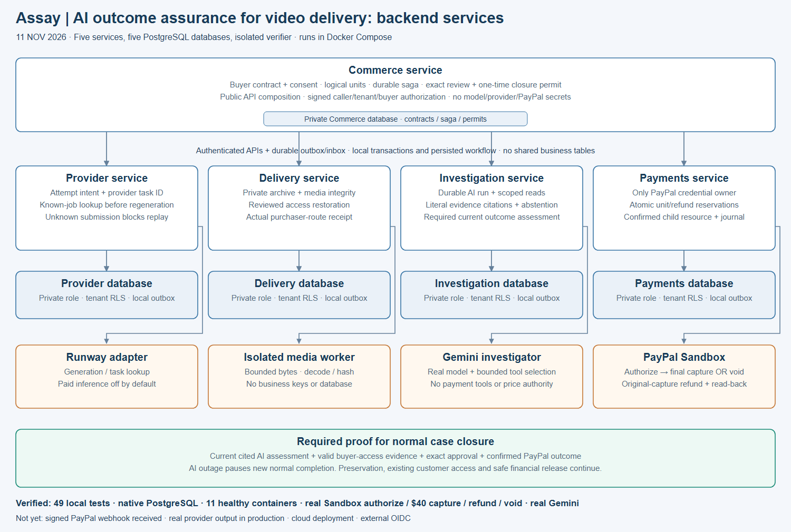

# Assay: AI outcome assurance for video delivery

**Charge only for the AI clips a buyer actually got, and recover the ones that were made but never arrived before anyone pays again.**

AI-video apps lose money twice when a render "fails". They pay the provider again for a video that already exists, or refund a customer for work that was actually done. Assay finds the finished video, proves the buyer can retrieve it through their own authenticated route, and settles through PayPal for exactly the clips delivered. To assay something is to test it before you pay for it.

## Why this happens

Generation APIs delete outputs on a timer:

- Runway: 24–48 hours ([docs](https://docs.dev.runwayml.com/assets/outputs/))
- Google Veo: 2 days ([docs](https://aistudio.google.com/docs/veo))
- Replicate: 1 hour ([docs](https://replicate.com/docs/topics/predictions/data-retention))

If an app's callback, worker or download step fails inside that window, a finished, paid-for video is lost. Today the app pays to render it again or refunds the sale.

## The story in 30 seconds

1. A buyer orders 10 clips at $5. PayPal authorizes **up to $50**.
2. Seven arrive. Clip 8 was rendered, but its delivery was lost. Clips 9 and 10 failed.
3. The buyer writes: *"Clip 8, 9 and 10 never showed up, refund me everything."*
4. **AI reads the message** into clip-level claims with literal quotes. **Rules decide:**
   - Clip 8 exists, so it's recovered.
   - Clips 9 and 10 don't, so they won't be charged.
   - "Refund everything" goes to the merchant, not to an automatic action.
5. The original clip 8 is **restored instead of re-rendered**, and its retrieval by the buyer is verified.
6. The merchant approves one exact amount, and PayPal **captures $40 once**. A double click does nothing.
7. The capture carries a per-clip note for the buyer's PayPal record: *"Charged $40.00 for 8 of 10 clips delivered. $10.00 of your $50.00 authorization was not taken."* This is fixture-tested; it hasn't yet been seen in a real Sandbox buyer record.
8. Separately from PayPal's record, the buyer gets Assay's **signed per-clip statement**, which anyone can verify.

## For judges

- **Live Sandbox:** https://assay-34-59-154-73.sslip.io. Choose **Try as merchant**, then **Start here**. Each visitor gets an isolated demo workspace (its own merchant, buyer and data) for 24 hours. Demo sessions can't reach payment controls or API keys.
- **Approving the PayPal hold** needs a PayPal Sandbox *personal* test account; its login is in the Devpost testing instructions. Money is Sandbox only.
- **Clips in the hosted demo:** a demo provider stands in for the video provider, and the screen labels it. Seven clips arrive, clip 8 is archived but undelivered, and clips 9–10 never render.
- **Merchant API:** the Postman collection is in [backend/docs/postman](backend/docs/postman). The sign-up invite code is in the Devpost testing instructions.
- **Landing page:** https://assay-sandbox.onrender.com.

What each piece of evidence does and doesn't prove is in the Evidence table below.

## Try it (no keys, no network, no money)

With Docker only (nothing else to install; the container has no network access):

```bash
cd backend
docker compose -f infra/compose.demo.yaml run --rm demo
```

Or with Node 22.20+, npm, and FFmpeg/FFprobe on PATH:

```bash
cd backend
npm ci
npm run demo
```

To run the full microservice stack in containers (five services, five PostgreSQL databases and the isolated media verifier), see [OPERATIONS.md](backend/docs/OPERATIONS.md#containers-11-november).

The demo runs all five services in one process on fixture PayPal, fixture AI and a locally encoded test MP4, and prints each step above. `npm run demo -- --real-ai` uses real Gemini for the AI steps; it needs a free-tier key in `.env` (see `backend/docs/INTEGRATIONS.md`). The full local quality gate is `npm run verify:local`.

### See it in the browser

```bash
cd backend && npm ci && npm run provision
cd ../frontend && npm ci && npm run demo:ui
```

Open the printed case URL. You get the merchant investigation workspace, the buyer's delivery and the payment record, running on the same five services with fixture AI, fixture PayPal and a clip labeled as synthetic. The landing page at `/` also has a walkthrough that needs no backend at all. Details: [frontend/README.md](frontend/README.md).

## Where AI and PayPal are essential

| Step | AI | Rules / people | PayPal |
|---|---|---|---|
| Buyer explains the problem in their own words | Reads free text into clip numbers, issue types and literal quotes; flags attempts to instruct the system | Validates the quotes and clip numbers, then decides each clip from delivery and payment records | — |
| A clip looks missing | Investigates provider, delivery and payment evidence with scoped read tools and cites what it used | Checks the citations and current evidence; restores only a verified original | — |
| Buyer approves the order | — | Immutable contract: unit count, price, ceiling | Orders API **AUTHORIZE** for the ceiling |
| Settlement | Cannot set prices, approve or move money | Server computes the amount from verified clips; the merchant approves an expiring, exact proposal | **One final partial capture** carrying a per-clip `note_to_payer` and `invoice_id`, or a **void** when nothing was delivered |
| After settlement | — | Refunds are bounded by the confirmed capture | **Refunds** linked to the original capture; read-back before anything is shown as paid |

## What is different

| Other entries | Their approach | This product |
|---|---|---|
| OfferSDK | Decides what a user may do *before* the work: plans, entitlements, offers, PayPal subscriptions, agentic cancel flows | Proves what the buyer actually got *after* the work: recovers output that already exists, then settles per clip against proof of delivery. The two are complementary ([comparison](product/REAL_USER_READINESS.md)) |
| Pay-on-proof and escrow entries | AI judges the work and PayPal releases funds | AI never judges or releases money. It reads evidence and the buyer's words; rules decide; PayPal moves an exact amount once |
| "Refund failed renders" | Refund after the fact | Never charges what wasn't delivered, so there's nothing to refund |

## Plug it into your app

Keep your provider and your generation code. Register each provider task as you submit it, and Assay archives the output when it finishes. It works with Runway or Replicate (looked up with your key) or any other provider (you report the output URL from a host you approved in advance). Signed webhooks tell your app when a clip was recovered, when PayPal settled, and when a buyer opened a PayPal dispute. Three steps: [INTEGRATE.md](backend/docs/INTEGRATE.md).

- **Sign up and get keys.** You get a secret key for your server. An `integration` key can register work but can never approve a charge. Short-lived buyer tokens go to your buyer's browser.
- **SDK.** `@assay/node` is in [backend/sdk](backend/sdk); it is not published to npm yet.
- **Currencies.** Price batches in USD, EUR, GBP, CAD, AUD or JPY.
- **Disputes.** While a PayPal dispute is open, refunds pause so the buyer is never paid twice. The signed statement is ready to attach as evidence.
- **Your own PayPal account.** Merchants can connect their own account through PayPal partner onboarding. This needs PayPal's partner approval first.

What a production merchant still needs: [REAL_USER_READINESS.md](product/REAL_USER_READINESS.md). Hosting plan: [DEPLOY.md](backend/docs/DEPLOY.md). How each sponsor's technology is used: [SPONSORS.md](backend/docs/SPONSORS.md).

## Evidence

Each line says what kind of evidence it is.

| Claim | Evidence | Kind |
|---|---|---|
| $50 authorization → $40 final capture, $5 refund on the original capture, separate void | `backend/evidence/paypal-lifecycle.json` | Real PayPal Sandbox, adapter level |
| Five services, real Gemini, real Sandbox approval, one confirmed $40 capture | `backend/evidence/service-sandbox-workflow.json` | Real Gemini and Sandbox; fixture media |
| A real AI-generated clip recovered and delivered byte-identical | `backend/evidence/generated-video-fixture-paypal.json` | Real LTX output; fixture payment |
| AI reading of buyer messages: Gemini 25/30 vs keyword baseline 15/30, all 30 answered, 0 invalid readings. An earlier run scored 18/30 because 7 cases hit Google outages | `backend/evidence/claim-reading-evaluation.json` | Real Gemini; 30 authored held-out messages; second single run, no variance estimate |
| AI action choice on structured facts vs rules | `backend/evidence/investigation-evaluation.json` | Real Gemini 17/20, rules 20/20. This is why AI does not decide actions |
| Concurrency, RLS, money bounds, encrypted restore | `backend/evidence/native-postgres.json` | Native PostgreSQL, local |
| Full local gate: 70/70 tests (including task intake, auto-archive, signed webhooks, the PayPal return redirect, API keys and scopes, EUR settlement, disputes, merchant PayPal onboarding, GCS storage, Vertex AI and the SDK), native PostgreSQL, build | `backend/evidence/local-quality.json` | Local, fixtures |
| A real cloud browser (KERNEL) fetched a clip over the internet, matched its SHA-256 and played it, with a session replay. Assay uses this as external playback proof for delivered clips | `backend/evidence/kernel-playback.json` | Real KERNEL; public CC0 clip, not yet an Assay-hosted clip |
| The merchant Postman collection (sign-up, keys, idempotency, scopes, buyer session, PayPal hold, rotation) run headless with Newman: 21 of 21 assertions pass | `backend/evidence/postman-run.json` | Local HTTP; fixture PayPal and AI |
| Microservices in Docker: 11 healthy containers, signed cross-service calls, real Gemini via the Investigation container | `backend/evidence/container-smoke.json` | Local Docker, 11 November build; not rerun on the 12 November additions; no PayPal order or generation |

## Architecture



Five services (Commerce, Provider, Delivery, Investigation, Payments), each with its own PostgreSQL database and row-level security. A transactional outbox connects them, and an isolated media verifier with no credentials checks every file.

- **Payments** alone holds PayPal credentials and the cash journal.
- **Investigation** alone talks to models.

Why the split is worth it: [ARCHITECTURE.md](backend/docs/ARCHITECTURE.md#why-five-services-instead-of-one-app). API: [API.md](backend/docs/API.md). Verification: [VERIFICATION.md](backend/docs/VERIFICATION.md).

## Impact

- **Buyers** pay only for clips verified as retrievable through their own route, with no credit chasing, and get a statement they can check.
- **Merchants** keep revenue for work that was really done, skip duplicate renders, and get messages answered from records.
- **Compute:** a recovered clip is one GPU render that never had to run twice.

`GET /v1/operations/impact` reports these from the merchant's own records. The re-render cost uses a merchant-configured estimate, not a measured price.

## Limits, stated plainly

- PayPal is Sandbox only. The new per-clip `note_to_payer` is fixture-tested and has not yet been sent to real Sandbox.
- These are tested with fixtures only:
  - non-USD currencies
  - disputes
  - merchant PayPal onboarding, which also needs PayPal partner approval
  - GCS storage
  - Vertex AI

  Only USD has run on real Sandbox.
- Signed webhook delivery is implemented and fixture-tested, but not yet received from PayPal (it needs a public HTTPS listener).
- The production video adapter is Runway, but it is unconfigured. The real clip came from the public LTX demo.
- The hosted Sandbox is a single-VM pilot (one e2-medium VM: services, databases and media verifier together). Workers process tenants one at a time, clips are buffered whole (25 MB cap), and cross-database restore and failover are not yet tested. External login (OIDC) is implemented but not exercised; the hosted demo uses isolated demo workspaces instead.
- Demand evidence is user reports and provider documentation, not merchant interviews. Economics are illustrative.

More: [problem statement](product/PROBLEM_STATEMENT.md) · [PRD](product/PRD.md) · [design](DESIGN.md)
