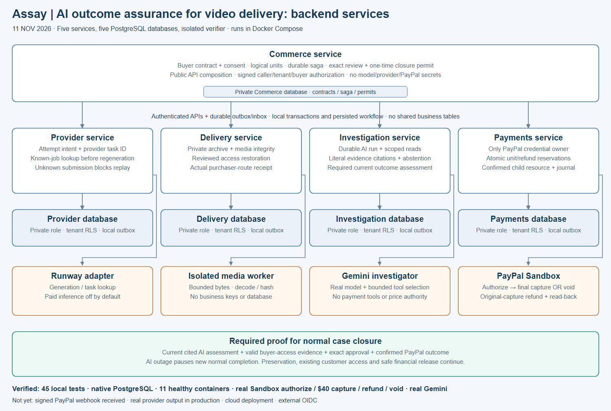
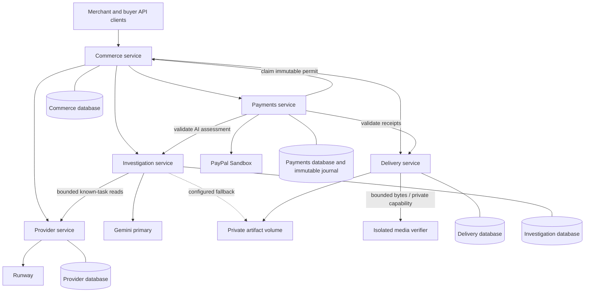

# Implemented backend architecture

8 November 2026 · Prototype inventory and target deployment boundaries

This document supersedes the earlier modular-application design for implemented backend behavior. Product terms remain one merchant, USD, 1–10 technically valid short clips, explicit consent, purchaser access before final capture and merchant capture-failure risk. [Implementation scope](../../product/BACKEND_IMPLEMENTATION_PROPOSAL.md)

[Download scalable SVG](architecture.svg)

## Ownership and state

Each service has its own runtime identity and database. Shared TypeScript packages provide transport, schema, error and tenant-scoped persistence mechanics. They cannot access another service's database handle. Local embedded PostgreSQL is persistent per process; Compose uses five physical PostgreSQL containers with separately restricted logins. This does not demonstrate deployed high availability.

Commerce owns accepted contract, logical units, buyer/merchant authorization, assessment adoption, proposals, permits and the workflow saga. Provider owns one attempt per logical unit in P0, task correlation and provider observations. Delivery owns private bytes, technical checks, publication and purchaser-route receipts. Investigation owns redacted snapshots, bounded model/tool activity and versioned assessments. Payments alone owns PayPal credentials, operation reservations, final unit allocation, refund bounds, cash journal and provider reconciliation.

## Protocol and consistency

Every command is authenticated with a short-lived signed token naming issuer, target audience, tenant, environment, subject and role. Receiving routes allowlist issuers. Commerce's local approval transaction binds an exact version/evidence/amount and writes its outbox. Payments claims the permit through an idempotent authenticated call, then reserves its operation and units locally. A network request cannot participate in the original database transaction; local outbox delivery and repeated read-back bridge the boundary.

The transport is authenticated internal HTTP with durable retries and target-side state/idempotency protection. There is no broker, service mesh or distributed transaction claim. Each outbox row carries a persistent ID, tenant, target, path, bounded payload, attempts, lease and schedule. Aggregate snapshots and signed authority establish current state; queued delivery order alone is not authoritative. Dead letters are visible through scoped metrics.

Provider submit intent is persisted before dispatch. A timeout without a task ID stays SUBMISSION_UNKNOWN. AI assessment intents are persisted and executed through Investigation's outbox, so public requests need not wait for model inference. An interrupted run becomes WAITING_FOR_AI. A real, cited, current assessment is mandatory for normal recovery/closure. Deterministic validators and human approval govern allowed actions and exact prices.

Payments marks an operation DISPATCHING under lock before its external call. It never repeats an operation already pending/unknown merely because a browser retries. Verified child capture/amount/currency/payee/source association establish cash. Pending/unknown stays unresolved. Confirmed journal, cash account and outbox outcome commit atomically. Refund reservations count against the captured balance while pending. Audit and financial journal deny runtime updates/deletion.

## Failure boundaries

Cancel before permit claim revokes authority and queues a safe release. A claimed/dispatched operation requires known provider state before remedy. A dispatch pause serializes against new capture/normal refund dispatch, while read-back and explicit safe fund remedies remain available. Previously delivered files do not disappear during an AI outage. Provider-result preservation does not require a successful model call.

Lost capture responses can be resolved only using a known resource ID or an unambiguous matching capture on the original order. Otherwise the operation stays NEEDS_REVIEW. Unknown refunds without a correlated resource ID require manual supported reconciliation. No replacement operation key is invented. A new model investigation never changes the original financial history.

## Media and storage

Only an authorized provider task supplies download URLs. Exact-origin allowlisting, pinned DNS resolution, public-address checks, redirect rejection, byte limits and timeouts restrict fetches. Output is quarantined, hashed and decoded. Production uses a dedicated verifier worker with no database/provider/PayPal credentials; Compose blocks its outbound network. The worker accepts bounded bytes under a capability token and deletes temporary inputs after verification. Local tests exercise it as a separate process, not as a claimed container sandbox.

Stored bytes are private on a single persistent Delivery volume in this prototype. Publication follows a supported reviewed AI action and actual content-route verification for the accepted buyer. Revalidation binds unit, contract, buyer and bytes to a short-lived receipt. Capture eligibility is technical retrievability, not human viewing or creative satisfaction. Multi-replica Delivery needs a shared object-store adapter, which is not shipped.

## Scaling, caching and deployment

HTTP/worker processes are independently deployable; model/video I/O dominates request work. Per-tenant admission caps constrain AI calls and new inference is disabled by default. Financial state is never cached as a success signal. OAuth tokens use bounded in-process expiry caching; buyer content is private/no-store. Database indexes cover tenant/kind/batch, due outboxes and unique unit attempts/allocations. Maintenance queries filter active/due work rather than repeatedly selecting already completed rows.

The first code does not establish the PRD's 5,000-unit/day target. A local 50-request empty-list benchmark and five-process smoke are recorded separately. Native PostgreSQL pooled concurrency, tenant grants, financial bounds and encrypted database restore have now been exercised locally. Distributed load, complete media/cross-service restore RPO/RTO and cloud rollout remain unexecuted gates. [Operations](OPERATIONS.md) · [Security review](SECURITY_REVIEW.md) · [Verification](VERIFICATION.md)

Operations hardening: outbox completion/failure updates bind the claimed attempt, so a late expired worker cannot overwrite a newer claim. Webhook receipt and its reconciliation enqueue commit together; lookup uses tenant/provider-reference indexes rather than a first-page scan. Operator-only `/v1/operations/health` exposes counts and queue age without raw customer evidence. Service JWT verification optionally uses an authoritative issuer-bound overlap key registry. See OPERATIONS.md for encrypted logical service snapshots and explicit restore limits.

## Frontend completion and web boundary — 10 November

Added the cookie-session web gateway under src/web. It serves built SPA assets and allowlisted same-origin Commerce/private-media routes, validates OIDC code/PKCE/nonce/issuer/audience, maps verified subjects to provisioned membership and derives internal authority server-side. Browser bearer headers cannot elevate role. Secure HttpOnly cookies, CSRF/origin checks and session revocation protect writes. Development helper remains loopback-only and is absent from production assets. Production requires a separate PostgreSQL web store, migration credentials, external OIDC configuration and service access; external identity login has not been executed.

Added safe environment/readiness, aggregate operation health, batch financial/activity projections, original-task lookup and retained support cases. Normal refunds require an exact expiring review tied to capture, allocation, amount and assessment, validated while reserving funds atomically; same-key replay returns the original reservation. Review metadata contains no credentials or provider signed URLs. Existing financial invariants remain authoritative.

## Why five services instead of one app

Each boundary isolates one kind of risk, so a bug or compromise in one place can't reach the others:

1. **Money:** only Payments holds PayPal credentials, the cash journal and refund bounds. Nothing else can move money, including the AI.
2. **Credentials:** the provider key, the model keys and the PayPal keys each live in exactly one service.
3. **Untrusted bytes:** provider media is decoded by an isolated verifier with no credentials and no network.
4. **AI:** Investigation can only read through scoped tools and return cited proposals. Commerce and Payments re-check every proposal against rules and current evidence.

The cost is operational: five processes, five databases and an outbox between them. For a single small merchant, one process would also work. The boundaries exist so that the money and credential guarantees hold as the product grows.
